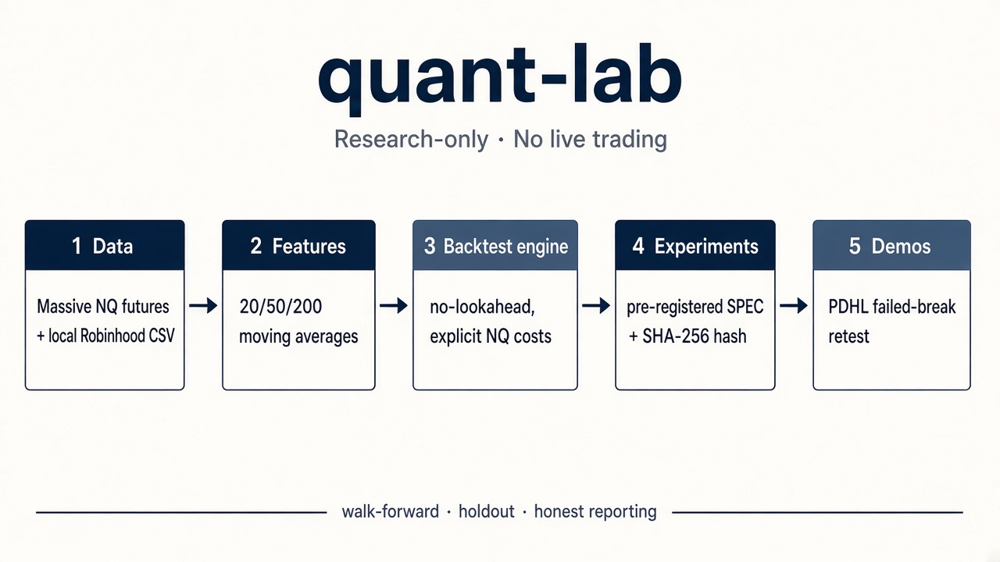

# Engineering Showcase

**Denzell Richardson** — Python / ML engineering portfolio built as real, tested projects (not tutorial dumps).

Target roles: **ML Engineer**, **Quant Research (junior)**, **Data / Python Engineer**, and adjacent IT / cloud support roles.

> Shipped work lives under [`projects/`](projects/). **quant-lab** is project 7 (`projects/07-quant-lab/`). If you only see TerraTrend on `main`, open or merge [PR #2](https://github.com/Staticshock1013/engineering-showcase/pull/2).

## Hire-ready highlights

Two projects you can clone, run, and review today:

| Project | What it proves | Status |
|---------|----------------|--------|
| **[quant-lab](projects/07-quant-lab/)** | Research discipline: pre-registered SPECs, no-lookahead backtests, explicit NQ costs, honest SPENT results | Showcase ready |
| **[TerraTrend Global](projects/06-terratrend-global/)** | Geospatial data pipeline: authenticated NASA MODIS LST/NDVI, QC gates, Streamlit UI | Verified MVP |

### quant-lab

[](projects/07-quant-lab/)

Research-only NQ futures + equity backtesting. **No live trading.**

- Pre-registered experiments (`SPEC.md` + SHA-256) before results
- No-lookahead engine; NQ commission **$2.50 / side**
- Front-month roll by session volume (Massive has no continuous NQ)
- Portfolio demo: SPY PDHL failed-break → retest (underlying points only)

```bash
cd projects/07-quant-lab && python3 -m venv .venv && source .venv/bin/activate
pip install -e ".[dev]" && pytest -q && python examples/pdhl_demo/pdhl_backtest.py
```

### TerraTrend Global

Streamlit dashboard over authenticated NASA MODIS samples (six cities), NDVI caches, and fixed-season series — period-level verified samples only (not annual means or decision-ready products).

```bash
cd projects/06-terratrend-global && ./test.sh
```

## Skills this repo demonstrates

| Area | Evidence in-repo |
|------|------------------|
| Python packaging & CLI | `quant-lab` pyproject + Typer CLI |
| Testing & CI | pytest suites + path-filtered GitHub Actions |
| Research hygiene | Frozen SPEC/HASH, SPENT holdout labeling |
| Data engineering | Futures roll, MODIS decode/QC, fixture vs live separation |
| Honest docs | Limitations called out; no fabricated production metrics |

## Full project roadmap

| # | Project | Stack | Status | Target roles |
|---|---------|-------|--------|--------------|
| 1 | Developer Portfolio Website | React, TypeScript, Tailwind, Vercel | Planned | All technical roles |
| 2 | IT Service Desk Simulator | React, TypeScript, FastAPI, SQLite, Python | Planned | Help Desk, IT Support, Junior Developer |
| 3 | Cloud Infrastructure Monitor | Python, FastAPI, Docker, Linux, C++ probe | Planned | Cloud Support, IT Operations, Data Center Tech |
| 4 | Security Operations Lab | Python, C++ log parser, Linux | Planned | SOC Trainee, Security Support |
| 5 | QA Automation Testing Suite | Playwright, TypeScript, GitHub Actions | Planned | QA Intern, Junior QA Engineer |
| 6 | **[TerraTrend Global](projects/06-terratrend-global/)** | Python, Streamlit, Plotly, NASA MODIS | **Verified MVP** | Data / Python, Geospatial, Climate tech |
| 7 | **[quant-lab](projects/07-quant-lab/)** | Python, pandas, scikit-learn | **Showcase ready** | ML Engineer, Quant Research |

Also featured (separate repo): **Career Intelligence OS** — AI-assisted career planning (TypeScript).

See [ROADMAP.md](ROADMAP.md) for milestones and [PROGRESS.md](PROGRESS.md) for the daily build log.

## Standards every project meets

- A working live demo or a reproducible local setup (one command where possible).
- A README covering the problem, architecture, technologies, and how to run and test it.
- Meaningful automated tests that run in CI.
- A "Technical challenges solved" section.
- A short demo video (recorded by the author; a recording script is provided until then).
- No secrets in the repo, no fabricated users, no invented production metrics. All sample data is
  fictional and labeled as such.

## License

[MIT](LICENSE)
