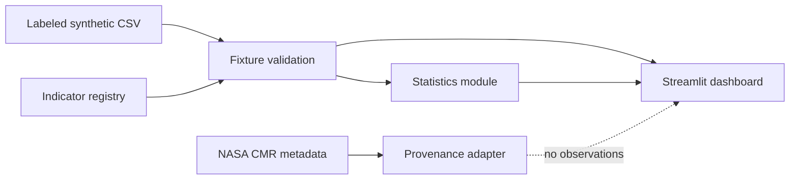

# TerraTrend Global — Phase 1–2 foundation

TerraTrend Global is a small, transparent MVP for exploring how a global environmental-change
dashboard can organize indicators, display regional context, and calculate repeatable summaries.

> **Data status:** every value shipped in Phase 1 is a labeled deterministic synthetic fixture.
> It is not real Earth observation data, is not derived from NASA products, and is unsuitable for
> scientific, policy, or operational decisions.

## What is included

- A typed global indicator registry for surface temperature, vegetation, and precipitation anomalies.
- A validated CSV fixture with 18 clearly labeled synthetic regional observations.
- A reusable, dependency-free statistics module for descriptive and regional summaries.
- A Streamlit dashboard with indicator selection, global map, regional comparison, and provenance
  disclosure.
- Deterministic pytest coverage for data labeling, empty inputs, numerical summaries, and grouping.

## Architecture



## Run locally

Python 3.12+ is recommended.

```bash
cd projects/06-terratrend-global
python3 -m venv .venv
. .venv/bin/activate
python -m pip install -r requirements.txt
streamlit run app.py
```

## Test

```bash
cd projects/06-terratrend-global
python -m pytest
```

## NASA access workflow investigation

On 2026-11-13, a request to the official NASA Common Metadata Repository (CMR) catalog endpoint
returned one matching collection for `short_name=MOD13Q1`:

```text
https://cmr.earthdata.nasa.gov/search/collections.json?short_name=MOD13Q1&page_size=1
```

The returned collection identifier was `C1748066515-LPCLOUD`. This verifies only that the public
catalog endpoint was reachable from the development environment at that time. It does **not**
verify Earthdata Login authorization, protected data-download access, API rate limits, product
selection, or a working production ingestion pipeline. No NASA credentials were requested,
stored, or used, and this MVP does not fetch live NASA data.

### Phase 2 verification: MOD11A2 for New York City

The preferred candidate is Terra MODIS `MOD11A2` version `061`, an 8-day land-surface-temperature
product. On 2026-11-13, the public CMR UMM-JSON granule query below returned four matches; its
first result was `MOD11A2.A2024001.h12v04.061.2024011195232`
(`G2834222407-LPCLOUD`, provider `LPCLOUD`) for a New York City bounding box and January 2024:

```text
https://cmr.earthdata.nasa.gov/search/granules.umm_json?short_name=MOD11A2&version=061&bounding_box=-74.10,40.60,-73.70,40.90&temporal=2024-01-01T00:00:00Z,2024-02-01T00:00:00Z&page_size=1
```

CMR identifies the HDF download as an `lp-prod-protected` URL. An unauthenticated request to the
official Earthdata profile endpoint redirected to sign-in. No `EARTHDATA_TOKEN` (or other
Earthdata credential configuration) was available, so **no protected data request was made**.

`terratrend.nasa` implements a public-metadata adapter that:

1. builds an explicit city/time/product CMR query;
2. validates the returned product/version and captures the catalog concept ID, provider, temporal
   coverage, declared data URL, and exact query URL in `GranuleProvenance`;
3. refuses protected download when `EARTHDATA_TOKEN` is absent; and
4. refuses to decode HDF data or return observations in all cases.

The module records candidate MOD11A2 scaling, QA, and 8-day compositing expectations only as
requirements for a future ingestion implementation. They were **not** verified against an
authorized downloaded granule, no QC filtering or temporal aggregation was performed, and no real
observation has been saved or displayed.

## Known limitations

- The map uses one representative coordinate per synthetic region, not gridded geospatial data.
- Two fixture months support UI prototyping only; they do not establish trends.
- Values are simple anomalies with no uncertainty, quality flags, temporal aggregation, or
  scientific baseline provenance.
- The Phase 2 metadata adapter does not download HDF files, decode MODIS QA flags, aggregate
  pixels, or create real observations.
- The map is still exclusively driven by synthetic fixtures; it intentionally ignores NASA catalog
  metadata.

## Next steps

1. Select authoritative products and document their spatial, temporal, and quality semantics.
2. Implement credential-safe, rate-aware ingestion after confirming authorized access.
3. Add provenance, uncertainty, quality flags, and tests around transformation rules.
