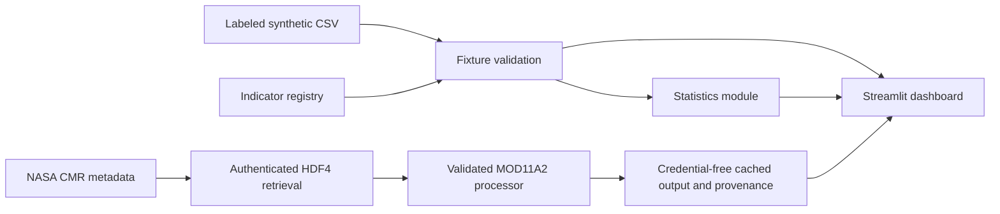

# TerraTrend Global — Phase 2 validated sample

TerraTrend Global is a small, transparent MVP for exploring how a global environmental-change
dashboard can organize indicators, display regional context, and calculate repeatable summaries.

> **Data status:** the global dashboard charts are labeled deterministic synthetic fixtures and are
> unsuitable for scientific, policy, or operational decisions. Separate, cached MOD11A2 v6.1
> land-surface-temperature samples and one MOD13A2 v6.1 NDVI sample are processed from
> authenticated source data with provenance. None is a global, annual, or decision-ready result.

## What is included

- A typed global indicator registry for surface temperature, vegetation, and precipitation anomalies.
- A validated CSV fixture with 18 clearly labeled synthetic regional observations.
- A reusable, dependency-free statistics module for descriptive and regional summaries.
- A Streamlit dashboard with indicator selection, global map, regional comparison, and provenance
  disclosure.
- A validated HDF4 MOD11A2 decoder with documented scaling, QC filtering, sinusoidal spatial
  sampling, a duration-weighted annual aggregation function, and deterministic tests.

## Architecture



## Run locally

Python 3.12+ is recommended.

```bash
cd projects/06-terratrend-global
python3 -m venv .venv
. .venv/bin/activate
python -m pip install -r requirements.txt
streamlit run app.py
```

## Test

```bash
cd projects/06-terratrend-global
python -m pytest
```

## Phase 3/5 readiness documents

- [Architecture](docs/architecture.md)
- [Methodology](docs/methodology.md)
- [Data sources and provenance](docs/data-sources.md)
- [Limitations](docs/limitations.md)

## NASA MOD11A2 verified sample

Terra MODIS `MOD11A2` version `061` is an eight-day, 1200×1200 (nominal 1 km) sinusoidal
land-surface-temperature product. An authenticated retrieval processed
`MOD11A2.A2024001.h12v04.061.2024011195232`
(`G2834222407-LPCLOUD`, provider `LPCLOUD`) for a New York City bounding box and January 2024:

```text
https://cmr.earthdata.nasa.gov/search/granules.umm_json?short_name=MOD11A2&version=061&bounding_box=-74.10,40.60,-73.70,40.90&temporal=2024-01-01T00:00:00Z,2024-02-01T00:00:00Z&page_size=1
```

The same validated workflow also processed the geographically distinct London granule
`MOD11A2.A2024177.h17v03.061.2024186042347` for 2024-06-25 through 2024-07-02.

The decoder validates the retrieved file metadata against the [official MOD11 User Guide
v6.1](https://lpdaac.usgs.gov/documents/715/MOD11_User_Guide_V61.pdf): `LST_Day_1km` must be
Kelvin, have valid range 7500–65535, fill value 0, scale factor 0.02, and offset 0. It accepts
only `QC_Day` pixels with mandatory QA bits 0–1 equal to `00` (good quality) and LST error bits
6–7 no greater than `01` (≤2 K). Pixel centers are transformed from the documented MODIS
sinusoidal tile grid and sampled only inside the stated bounding box.

`terratrend/processed/mod11a2_nyc_2024-01-01.json` and
`terratrend/processed/mod11a2_london_2024-06-25.json` are credential-free cached results with CMR
provenance, source URL, processing rules, and counts. They are validated against
`VERIFIED_DATA_REGISTRY` before dashboard display. No token is stored in source or output.
`annual_mean_celsius` is duration-weighted so a shorter final composite does not receive an
eight-day weight, and it rejects incomplete or non-contiguous calendar coverage. It remains a
reusable function rather than a claimed annual result: each cached result contains one eight-day
composite only.

## NASA MOD13A2 verified NDVI sample

An authenticated New York City retrieval processed
`MOD13A2.A2024177.h12v04.061.2024195022551` for 2024-06-25 through 2024-07-10.
The adapter validates `MOD13A2` v061 catalog metadata, the HDF4 NDVI valid range (-2000 to
10000), fill value (-3000), and detailed-QA/pixel-reliability schemas against the [official MOD13
User Guide v6.1](https://lpdaac.usgs.gov/documents/621/MOD13_User_Guide_V61.pdf). The published
NDVI scale is 0.0001; the retrieved file records its inverse divisor (10000), so accepted raw
values are divided by 10000 after validation.

Only pixels with detailed VI-quality bits 0–1 equal to `00` and pixel reliability equal to `0`
(good data) are sampled within the complete New York City bounding box. The period-level,
credential-free cache is `terratrend/processed/mod13a2_nyc_2024-06-25.json`. It is selectable in
the dashboard’s verified-data variable control and is not an annual value or trend.

## Safe city comparison and CSV export

The dashboard keeps verified period caches separate from synthetic global fixtures. It exports
verified cache CSVs with product/version, period coverage, pixel counts, QC/spatial methodology,
and CMR provenance; synthetic-fixture exports retain their non-observational label and fixture
methodology.

A city comparison is enabled only when exactly two verified caches have the same product/variable,
unit, aggregation status, exact time interval, and QC/spatial-sampling method. Different products,
different periods, synthetic fixtures, and incomplete/non-annual data are refused rather than
shown as a misleading city difference. The January New York City LST sample and the June London
sample remain incompatible, but a separately validated New York City cache for 2024-06-25 through
2024-07-02 now matches the London period and is eligible for a period-level LST comparison. It is
not an annual or trend comparison.

## Safe batch ingestion

`terratrend.ingestion` plans MOD11A2 product-aligned eight-day periods before making any network
request. Its default mode is a dry run: it writes a resumable `manifest.json` to `.terratrend-cache`
but does not query CMR, use `EARTHDATA_TOKEN`, or download HDF files.

```bash
# No-network annual plan: 46 expected 2024 periods, all marked planned_no_network.
python -m terratrend.ingestion --city london --years 2024

# No-network fixed-season plan: this is always period/season-level, never annual.
python -m terratrend.ingestion --city london --years 2024 \
  --mode fixed-season --season 06-25:07-02 --cache-dir .terratrend-cache/london-june
```

Apply mode is deliberately explicit and bounded. It requires `--apply` and refuses before network
access if pending periods exceed `--max-downloads`; it resumes existing processed outputs, waits
between requests, atomically retains raw HDF files in the runtime cache, and writes credential-free
per-period provenance. For a reviewed one-period retrieval:

```bash
python -m terratrend.ingestion --city london --years 2024 \
  --mode fixed-season --season 06-25:07-02 --apply --max-downloads 1 \
  --rate-limit-seconds 2 --cache-dir .terratrend-cache/london-june
```

Do not invoke an annual apply plan until its planned period count, expected storage, Earthdata
authorization, and scientific need have been reviewed. A cache can calculate an annual mean only
with complete contiguous calendar coverage. Fixed-season outputs and incomplete annual coverage
are explicitly ineligible for annual or multiyear trend claims; `require_multiyear_trend_claim`
also requires at least three complete annual results.

## Known limitations

- The map uses one representative coordinate per synthetic region, not gridded geospatial data.
- Two fixture months support UI prototyping only; they do not establish trends.
- Values are simple anomalies with no uncertainty, quality flags, temporal aggregation, or
  scientific baseline provenance.
- The verified sources are two geographically distinct eight-day composites; the global map remains
  synthetic.
- A real annual result requires complete, validated coverage for each year and is not shipped.
- P0 multiyear trend requirements remain incomplete: two isolated periods cannot establish annual
  values, interannual change, or a trend.

## Next steps

1. Retrieve all annual MOD11A2 composites with retry/rate-limit handling and coverage checks.
2. Add uncertainty and coverage reporting appropriate to each downstream use.
3. Expand geographic validation, then build controlled annual coverage for multiple years before
   calculating trends.
