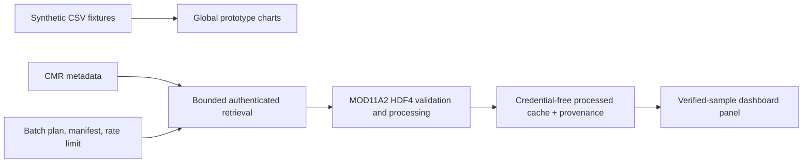

# Architecture

TerraTrend separates prototype display data from authenticated Earth-observation samples.

`app.py` always labels the global map and regional bars as synthetic. It loads only
registry-matched JSON files in `terratrend/processed/` for the separate verified-sample panel,
where the user selects an LST or NDVI variable. Expansion-city LST availability combines verified
caches with explicit unavailable markers from `terratrend/availability/` and renders a separate
availability map. Malformed caches fail closed: they are not shown and the synthetic prototype
remains available.

`terratrend.ingestion` is a plan-first command-line workflow. Its default dry run writes a
manifest only; apply mode is opt-in, download-bounded, rate-limited, resumable, and stores
runtime HDF/cache files under an ignored cache directory. Runtime batch caches are not
automatically promoted into the dashboard package.
