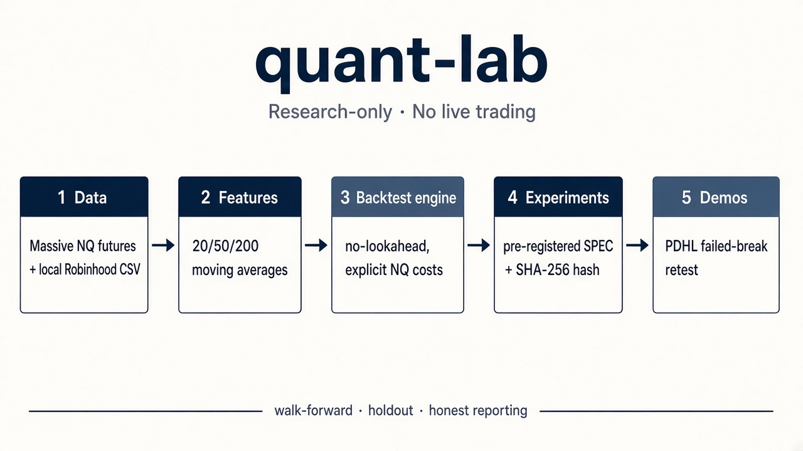
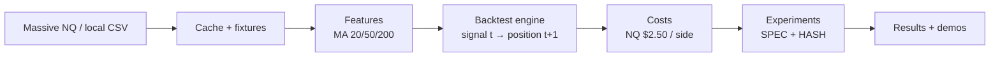

# quant-lab

Research-only equity and futures backtesting lab for an ML engineering portfolio.

**No live trading. No broker order placement.** Secrets stay in `.env` (gitignored). Raw market data stays under `data/` (gitignored); only small fixtures ship with the repo.

Monorepo path: [`projects/07-quant-lab/`](./).



*Pipeline: data → features → backtest (no-lookahead + explicit NQ costs) → pre-registered experiments → portfolio demos.*

## What this showcases

| Skill | How it shows up |
|-------|-----------------|
| Research discipline | Experiments freeze `SPEC.md` + SHA-256 `HASH.txt` before results |
| Correctness | No-lookahead guards; cost model attached to every result |
| Futures data engineering | Massive NQ aggregates + front-month roll by session volume |
| Honest reporting | Synthetic MA holdout marked **SPENT / not evidence** |
| Portfolio demos | SPY PDHL failed-break → retest (underlying points only) |

## Architecture



## Status

| Phase | Description | Status |
|-------|-------------|--------|
| 1 | Scaffold, CI, secrets hygiene | Done |
| 2 | Data layer + NQ front-month roll | Done |
| 3 | Backtest engine + cost / no-lookahead tests | Done |
| 4 | MA study (pre-registered; synthetic holdout spent) | Done* |
| — | PDHL portfolio demo (not a frozen experiment) | Done |
| 5 | NQ→stock lead/lag analysis | Planned |
| 6 | Walk-forward ML vs baseline | Planned |

\*Synthetic MA holdout is archived as non-evidential. Real-data evaluation needs local `data/ff_nq/` synced into the environment.

## Quick start

```bash
cd projects/07-quant-lab
python3.11 -m venv .venv
source .venv/bin/activate
pip install -e ".[dev]"
cp .env.example .env   # fill locally; never commit .env
quant-lab download-data --source fixtures
pytest -q
ruff check src tests examples/pdhl_demo
quant-lab version
python examples/pdhl_demo/pdhl_backtest.py
```

## Experiment protocol

1. Write `experiments/<name>/SPEC.md` (hypothesis, windows, metric, threshold, baseline, holdout).
2. Save SHA-256 of that file to `HASH.txt` and **commit before running results**.
3. Verify the hash before scoring; holdout is never used for tuning.
4. Report primary and secondary metrics; do not shop for the passing one.

## Results (honest)

### ma-study (synthetic) — SPENT, not evidence

- SPEC SHA-256: `dd4419213df4d74c313538496fc0b031d8dd34d24260922d392882ba9d035e96`
- Costs: **NQ $2.50 per side** (`usd_per_contract_per_side`) — not MNQ, not round-trip
- Archive: [`experiments/ma-study/RESULTS.md`](experiments/ma-study/RESULTS.md)
- Do **not** cite the synthetic holdout as a pass

### PDHL demo (portfolio illustration)

- Path: [`examples/pdhl_demo/`](examples/pdhl_demo/)
- Underlying SPY points only; round-trip **0.14** points; no options pricing
- Not `experiments/spy-pdhl-v1` (that frozen SPEC is not on this branch yet)

## Technical challenges solved

1. **No continuous NQ from Massive** — built front-month by highest session volume and documented unadjusted jumps.
2. **Lookahead leakage** — signals at close of `t` only become positions on `t+1`; causal SMAs are perturbation-tested.
3. **Cost honesty** — NQ commission/slippage are first-class fields on every result payload.
4. **Pre-registration** — hash-gated runners refuse mutated SPECs.
5. **Portfolio vs experiment separation** — demos live under `examples/`; frozen tests live under `experiments/`.

## Limitations

- Research only; not investment advice.
- Massive live pulls need `MASSIVE_API_KEY` (Cursor/GitHub secret — never paste into chat).
- MA study evidence on synthetic data is spent; real 1-min → daily path is prepared but needs `data/ff_nq/`.
- Lead/lag and walk-forward ML phases are not implemented yet.
- Unadjusted continuous futures jump at rolls unless back-adjust is enabled.

## License

MIT (same as the parent [engineering-showcase](../../) repo).
